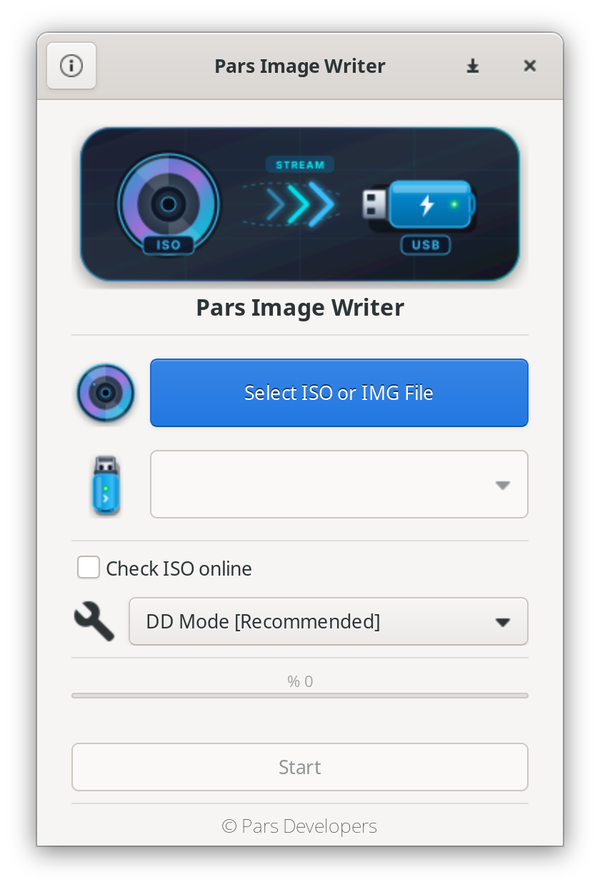
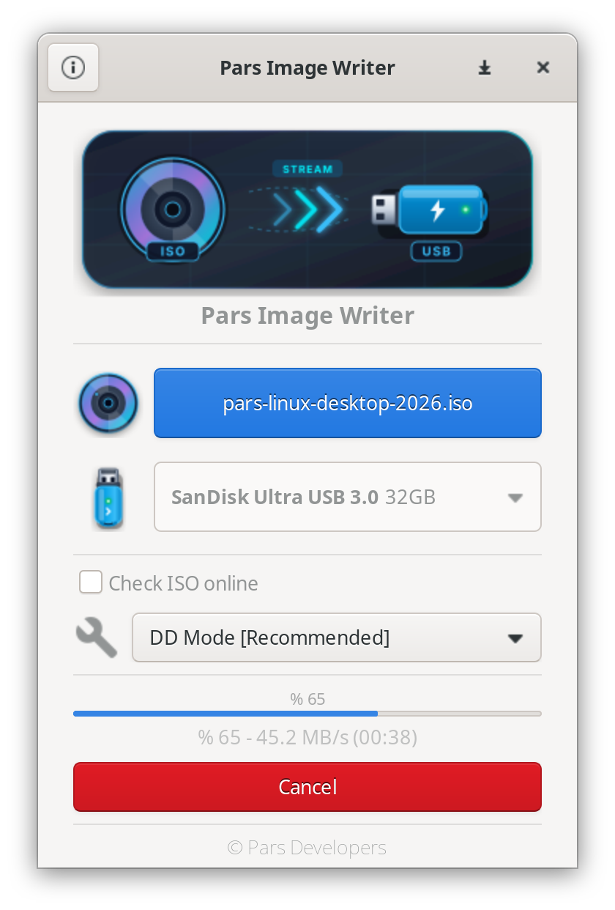

# Pars Image Writer 🚀

<div align="center">


**GNU/Linux sistemler için hızlı, güvenli ve modern USB disk kalıbı yazma aracı.**

[](https://www.gnu.org/licenses/gpl-3.0)
[](https://www.python.org/)
[](https://www.gtk.org/)
[](https://kernel.org)

[Özellikler](#-özellikler) • [Ekran Görüntüleri](#-ekran-görüntüleri) • [Kurulum](#-kurulum) • [Kullanım](#-kullanım) • [Dokümantasyon](#-dokümantasyon) • [Katkıda Bulunma](#-katkıda-bulunma)

</div>

---

## 📖 Genel Bakış

**Pars Image Writer**, `.iso` ve `.img` kalıp dosyalarını USB belleklere kolay, emniyetli ve yüksek performansla yazdırmak için geliştirilmiş açık kaynaklı bir masaüstü uygulamasıdır. Python 3 ve GTK+ 3 üzerine inşa edilmiş olup, hem son kullanıcılar hem de sistem yöneticileri için endüstri standardı güvenlik protokolleri sunar.

### ✨ Öne Çıkan Özellikler

- ⚡ **DD Modu (Doğrudan Yazma)**: Bayt-bayt ham yazma mekanizması (`O_DSYNC` ve `O_EXCL` bayrakları ile gerçek donanım hızında yazım).
- 🐧 **ISO Modu (GNU/Linux)**: Hedef USB diski FAT32 olarak bölümler, ISO dosyalarını ayıklar ve çift önyüklemeli (BIOS i386-pc + UEFI x86_64-efi) GRUB kurar.
- 🪟 **ISO Modu (Windows)**: Windows kalıpları için NTFS veri bölümü ve FAT32 UEFI önyükleme bölümü oluşturarak sorunsuz kurulum medyası hazırlar.
- 🛡️ **Kritik Sistem Koruması**: Sistem disklerinin (`/`, `/boot`, `/home`), aktif swap alanlarının ve LVM/LUKS şifreli kapsayıcılarının yanlışlıkla üzerine yazılmasını donanımsal ve mantıksal olarak engeller.
- 🔒 **Güvenli Yetkilendirme (PolicyKit)**: Arayüz kullanıcı haklarıyla çalışırken, yalnızca disk yazma işlemleri `pkexec` üzerinden izole edilmiş betiklerle root haklarıyla yürütülür.
- 📡 **Udev Entegrasyonu**: Tak-çıkar USB aygıtlarını anlık algılayan dinamik donanım izleme mekanizması.
- ⏱️ **Akıllı İlerleme Takibi**: Yazma hızını (MB/s) ve tahmini kalan süreyi dinamik hareketli pencere (sliding window) algoritmasıyla doğru biçimde görüntüler.

---

## 🖼️ Ekran Görüntüleri

<div align="center">

| Ana Yazma Ekranı | İşlem Tamamlandı |
|:---:|:---:|
|  |  |

</div>

---

## 📦 Kurulum

### Sistem Bağımlılıkları

Uygulamanın çalışması için gerekli sistem paketleri:

```bash
# Debian / Ubuntu / Pars tabanlı sistemlerde:
sudo apt update
sudo apt install -y python3-gi gir1.2-gtk-3.0 gir1.2-glib-2.0 \
                    python3-requests python3-pyudev parted dosfstools \
                    ntfs-3g pv eject udev
```

### Kaynak Koddan Çalıştırma

Projeyi klonlayıp doğrudan çalıştırabilirsiniz:

```bash
git clone https://github.com/pars/pars-image-writer.git
cd pars-image-writer
python3 src/Main.py
```

### Debian (.deb) Paketi Derleme

```bash
sudo apt install -y devscripts git-buildpackage debhelper dh-python
gbp buildpackage --git-export-dir=/tmp/build/pars-image-writer -us -uc
sudo dpkg -i /tmp/build/pars-image-writer/*.deb
```

---

## 💻 Kullanım

### Grafik Arayüz (GUI)
1. Menüden **Pars Image Writer** uygulamasını başlatın veya bir `.iso` / `.img` dosyasına sağ tıklayıp uygulamayı seçin.
2. Yazmak istediğiniz kalıp dosyasını ve hedef USB diski belirleyin.
3. Uygun modu seçin (Önerilen: **DD Modu**).
4. **Başlat** butonuna basın ve PolicyKit yönetici parolanızı girin.

### Komut Satırından Çalıştırma
```bash
# Doğrudan ISO seçerek başlatma:
pars-image-writer /yol/to/dagitim.iso
```

---

## 📚 Dokümantasyon

Projenin kapsamlı teknik ve operasyonel dokümantasyonu `docs/` dizininde yer almaktadır:

- 🏛️ [Mimari Tasarım (ARCHITECTURE.md)](docs/ARCHITECTURE.md)
- ⚙️ [Detaylı Kurulum Kılavuzu (INSTALL.md)](docs/INSTALL.md)
- 🖥️ [Komut Satırı Başvuru Rehberi (CLI_REFERENCE.md)](docs/CLI_REFERENCE.md)
- 🔒 [Güvenlik Politikası ve Mimarisi (SECURITY.md)](docs/SECURITY.md)
- 🛡️ [Veri Koruma & Sürücü Güvenliği Kılavuzu (DATA_SAVING_GUIDE.md)](docs/DATA_SAVING_GUIDE.md)
- 🧪 [Test ve Doğrulama Kılavuzu (TESTING.md)](docs/TESTING.md)
- 🌐 [Çeviri ve Yerelleştirme Rehberi (TRANSLATION_GUIDE.md)](docs/TRANSLATION_GUIDE.md)
- 🔌 [Masaüstü ve Sistem Entegrasyonu (UYGULAMA_BAGLAMA.md)](docs/UYGULAMA_BAGLAMA.md)
- 🌐 [Özel Dağıtım ve Yansıma Kılavuzu (SELF_HOSTING_GUIDE.md)](docs/SELF_HOSTING_GUIDE.md)
- 📜 [Hukuki Şartlar ve Sorumluluk Reddi (SARTLAR.md)](docs/SARTLAR.md)
- 🤝 [Katkıda Bulunma Rehberi (CONTRIBUTING.md)](docs/CONTRIBUTING.md)
- 🤖 [Claude & Yapay Zeka Ajan Kılavuzu (CLAUDE.md)](docs/CLAUDE.md)
- 📈 [Geliştirme İlerleme Raporu (progress.md)](docs/progress.md)
- 🔱 [Çatallama Beyannamesi & Köken (FORK.md)](docs/FORK.md)
- 📋 [Sürüm Politikası (VERSION.md)](docs/VERSION.md) & [Değişiklik Günlüğü (CHANGELOG.md)](docs/CHANGELOG.md)

---

## 🤝 Katkıda Bulunma

Topluluk katkılarını memnuniyetle karşılıyoruz! Lütfen hata bildiriminde bulunmadan veya kod göndermeden önce [Katkı Rehberimizi](docs/CONTRIBUTING.md) inceleyin.

---

## 📄 Lisans

Bu proje **GNU General Public License v3.0 (GPLv3)** ile lisanslanmıştır. Detaylar için [TERMS.md](docs/TERMS.md) ve proje lisans metinlerine göz atabilirsiniz.
